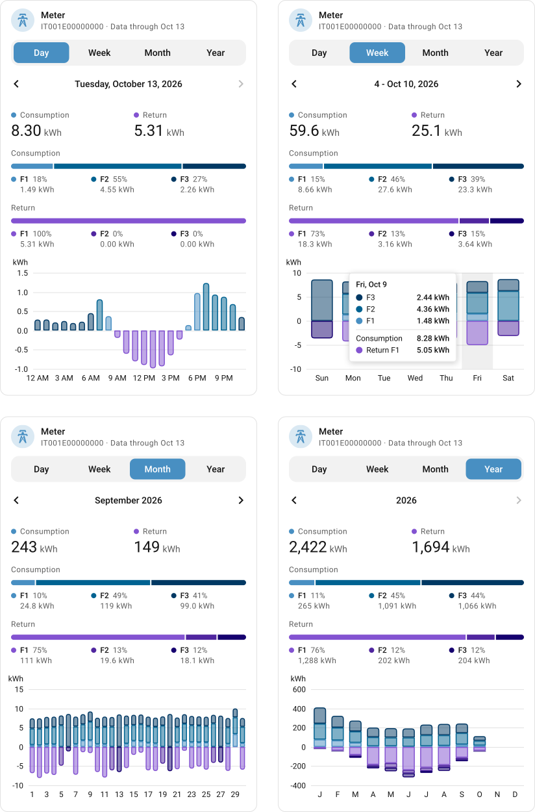
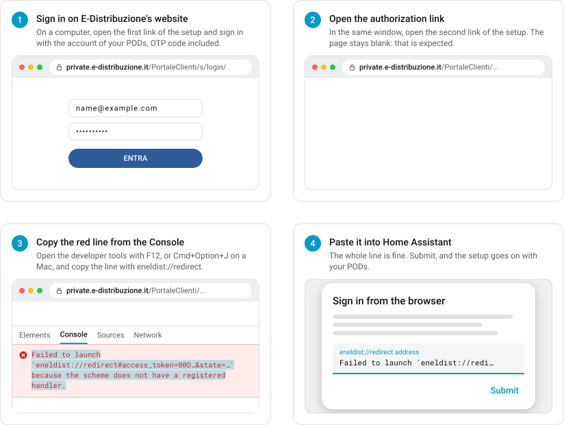
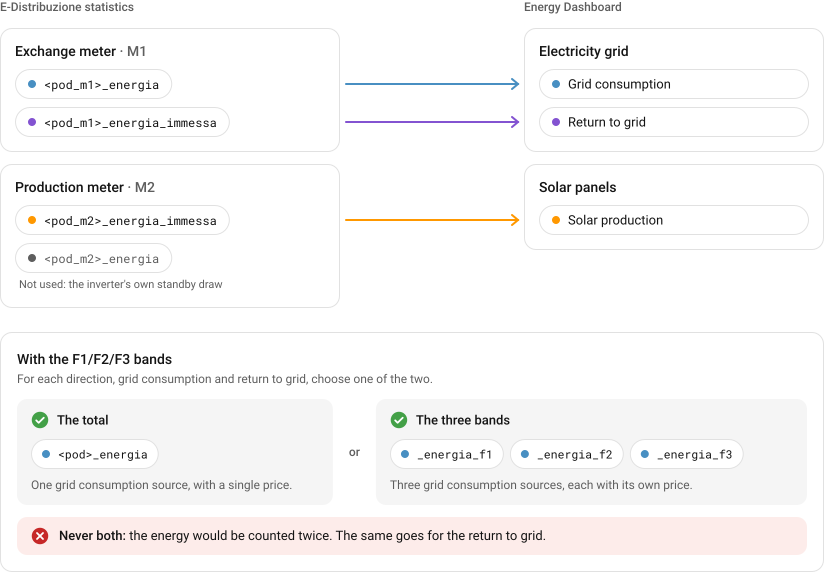

<p align="center">
  
</p>

<p align="center">
  <strong>Home Assistant integration for E-Distribuzione meters,<br>
  with 15-minute data and F1/F2/F3 time bands.</strong>
</p>

<p align="center">
  <a href="https://github.com/fabioscarparo/HomeAssistant-EDistribuzione/releases/latest"></a>
  <a href="https://hacs.xyz/"></a>
  <a href="https://www.home-assistant.io/"></a>
  <a href="https://www.python.org/"></a>
  <a href="LICENSE"></a>
</p>

Custom Home Assistant integration for **E-Distribuzione**, the main Italian
electricity distribution network operator. For every POD it imports the
15-minute readings of both directions as statistics ready for the Energy
Dashboard.

- **Consumption and injection**: the energy drawn from the grid and the
  energy returned to it, solar production included.
- **F1 / F2 / F3 time bands** for both directions, with the ARERA holiday
  calendar.
- **Energy Dashboard** set up with a single action.
- **POD card** with day, week, month and year views.
- **Current time band** sensor for automations.
- **Italian and English**, following each user's language.

<picture>
  <source media="(prefers-color-scheme: dark)" srcset="docs/images/pod-card-dark.svg">
  
</picture>

## Quick start

1. [Install](#installation) the integration with HACS and restart Home
   Assistant.
2. [Add it and sign in](#sign-in) from **Settings → Devices & services**.
3. [Fetch the history](#fetching-historical-data): setup imports only the
   last 3 days.
4. [Set up the Energy Dashboard](#energy-dashboard) with the **Configure
   Energy Dashboard** action.
5. [Add the POD card](#pod-lovelace-card) to a dashboard.

From then on new data arrives every evening on its own, see
[Daily updates](#daily-updates). Something not working? See
[Troubleshooting](#troubleshooting).

## Installation

### Requirements

- **Home Assistant 2025.4** or later, with [HACS](https://hacs.xyz)
  installed; the integration's icon shows from Home Assistant 2026.3
- The **email and password** of your E-Distribuzione customer area
- Access to the email address or phone number where the OTP code arrives

> [!IMPORTANT]
> Log out of the official E-Distribuzione app and website before setting up
> the integration. E-Distribuzione limits the number of concurrent sessions
> per account, and with too many open it sends no OTP code.

### Install with HACS

The integration is not in the default HACS store: add it as a custom
repository.

1. Open **HACS**, then **⋮ → Custom repositories**.
2. Add `https://github.com/fabioscarparo/HomeAssistant-EDistribuzione` with
   type **Integration**.
3. Search for **E-Distribuzione**, open it and select **Download**. HACS
   installs the latest release and lets you know when a new one is out.
4. Restart Home Assistant: **Settings → System**, power icon (top right) →
   **Restart Home Assistant**, or the **Restart required** notice in
   **Settings → Repairs**.

See [CHANGELOG.md](CHANGELOG.md) for what changed in each version.

### Manual installation

Copy `custom_components/edistribuzione/` into the `custom_components/`
folder of your Home Assistant configuration, then restart Home Assistant.

### Migrating from maurobraggio's repository

If you are coming from
[maurobraggio/HomeAssistant-EDistribuzione](https://github.com/maurobraggio/HomeAssistant-EDistribuzione),
remove **only the repository** from HACS, **not** the integration from
**Settings → Devices & services**, then add this repository as above. The
integration domain is the same, so the existing setup and data are kept.

## Sign in

Go to **Settings → Devices & services → Add integration** and search for
**E-Distribuzione**; if it does not appear, reload the page. Then choose how
to sign in:

- **Continue in browser (recommended)**: you sign in on E-Distribuzione's
  official website, which the block on automated access does not stop, and
  your password does not go through Home Assistant.
- **Use password and OTP**: Home Assistant signs in for you, with the email
  and password of your customer area and the OTP code you receive by email or
  SMS. E-Distribuzione can block it with its anti-bot check: the setup then
  offers the browser.

After signing in, choose the PODs to monitor if the account has more than
one. If something goes wrong, see [Sign-in errors](#sign-in-errors).

### Sign in from the browser

<picture>
  <source media="(prefers-color-scheme: dark)" srcset="docs/images/sign-in-browser-dark.svg">
  
</picture>

1. On a computer, open the first link shown in the setup, E-Distribuzione's
   website, and sign in with the account of your PODs, OTP code included,
   until you are in the customer area. If the browser is already signed in
   with another account, sign out first. Do not use a phone with the
   E-Distribuzione app: the app would open the final address.
2. In the same window, open the second link, the authorization link. The
   page stays blank or shows an error: that is expected, the final address
   is meant for the app.
3. Copy that address, which starts with `eneldist://redirect`. In Chrome and
   Edge open the developer tools (**F12**, or **⌥⌘J** on a Mac) and copy
   from the **Console** tab the red line that contains it; in other browsers
   it may show in the address bar. You can paste the whole line.
4. Paste it into the setup and submit.

The authorization link only works for the setup that showed it.

### Sign in with password and OTP

Only use the code that arrives after submitting your credentials here:
codes generated in the E-Distribuzione app or on the website belong to a
different login session and are always rejected.

- **No OTP code?** Tick **Request a new code**, leave the code field empty
  and submit the form.
- **Too many concurrent sessions?** Log out of the official app and website,
  wait a few minutes and try again.

## PODs and meter role

Each POD has a role, which only changes how entities and statistics are
named. **Both directions are always downloaded for every POD**, whatever its
role.

- **Regular / exchange meter**: the main electricity meter, the default.
- **Solar / production meter**: a meter dedicated to photovoltaic
  production.

With an exchange meter only there is nothing to change. With separate
exchange and production meters, for example a solar system with two meters,
go to **Settings → Devices & services → E-Distribuzione → Configure → Meter
type per POD** and set the production meter to **Solar / production meter**.
The role can be changed at any time.

From the same **Configure** menu you can **Add POD** from your account or
**Remove POD**; removing a POD keeps the statistics already imported.

## Fetching historical data

History is not downloaded automatically: right after setup the integration
imports only the **last 3 days**, to check that the POD and the login work.

1. Go to **Developer tools → Actions** and choose **E-Distribuzione: Fetch
   history**.
2. Fill in the fields:
   - **Setup / POD**: the **E-Distribuzione** device fetches all configured
     PODs; a single POD's device limits the fetch to that POD.
   - **Start date** and **End date**: the end date can be **yesterday at
     the latest**.
3. Select **Perform action** and wait: six months of data can take a few
   tens of seconds.

Each run covers up to **181 days**, about six months: for a longer history,
run the action over consecutive periods. Running it again over a period that
was already imported is always safe: samples are updated instead of
duplicated and corrections published by E-Distribuzione are applied.

A green check on the button means that at least one POD received data; a red
message says what to change. To see how much arrived, see
[Checking the imported history](#checking-the-imported-history).

<details>
<summary>Running it from YAML</summary>

```yaml
action: edistribuzione.recupera_storico
data:
  device_id: 4f1c9e0a7b2d4c3e8a6f5b1d2c3e4f50
  data_da: "2026-04-10"
  data_a: "2026-10-07"
```

Dates are written as year-month-day. If a field is wrong, the error says
what to change; errors about the `device_id` list the IDs of the
E-Distribuzione devices.

To find the `device_id`, go to **Developer tools → Template** and paste:

```jinja

{{ device_attr(d, 'name') }}: {{ d }}

```

It prints one line per device:

```text
E-Distribuzione: 4f1c9e0a7b2d4c3e8a6f5b1d2c3e4f50
POD IT001E12345678: 9a8b7c6d5e4f3a2b1c0d9e8f7a6b5c4d
```

The ID is also the last part of the device page's address, after
`/config/devices/device/`. If the template prints nothing, the integration
is not set up yet, or Home Assistant was not restarted after installing it.

</details>

## Daily updates

E-Distribuzione publishes data with a **one-day delay**. Every day from
**19:00** the integration requests the previous days, always rechecking the
last **3 days** so that later corrections are imported automatically. You
can change the hour in **Configure → Request time**.

The diagnostic sensors of each POD device show the most recent imported day:

| Meter role | Diagnostic sensors |
|---|---|
| Exchange | Last available date, Last day consumption, Last day return to grid |
| Production | Last available date, Last day production, Last day consumption (technical) |

They are read from the data already imported, so they stay available after
a restart and while E-Distribuzione cannot be reached; the **Day** attribute
says which day they refer to. A direction the meter never measured, such as
the return to grid without solar panels, shows 0 kWh.

## Energy Dashboard

<picture>
  <source media="(prefers-color-scheme: dark)" srcset="docs/images/energy-dashboard-dark.svg">
  
</picture>

### Automatic configuration

Run **E-Distribuzione: Configure Energy Dashboard** from **Developer tools →
Actions**. It adds the statistics of every configured POD according to its
role, and never overwrites or duplicates sources that already exist,
including those added by hand. Run it again after adding a POD or changing
a role, but not after switching to the
[F1/F2/F3 bands](#with-the-f1f2f3-bands).

### Manual configuration

Go to **Settings → Dashboards → Energy**. For a system with an exchange
meter (M1) and a production meter (M2):

| Energy Dashboard section | Statistic |
|---|---|
| Electricity grid → Grid consumption | `edistribuzione:<pod_m1>_energia` |
| Electricity grid → Return to grid | `edistribuzione:<pod_m1>_energia_immessa` |
| Solar panels → Solar production | `edistribuzione:<pod_m2>_energia_immessa` |

`edistribuzione:<pod_m2>_energia` is the consumption of the production
meter itself, typically the inverter's standby draw: it does not belong in
any dashboard section. Self-consumption and total home consumption are
calculated by Home Assistant, with no extra sensors.

### With the F1/F2/F3 bands

Instead of the total consumption you can add the
[three bands](#f1--f2--f3-time-bands) as three separate grid consumption
sources, each with its own price; the same goes for the injection, as three
return to grid sources with their own compensation.

> [!IMPORTANT]
> Never add the total *and* the bands of the same direction together, or
> the energy is counted twice. For the same reason, do not run **Configure
> Energy Dashboard** after switching to the bands: it adds the totals back.

## F1 / F2 / F3 time bands

For both directions the integration also writes three statistics, one per
ARERA time band, calculated from the same 15-minute samples as the total:

| Time band | Consumption | Injection |
|---|---|---|
| **F1**: Monday-Friday 08:00-19:00 | `edistribuzione:<pod>_energia_f1` | `edistribuzione:<pod>_energia_immessa_f1` |
| **F2**: Monday-Friday 07:00-08:00 and 19:00-23:00, Saturday 07:00-23:00 | `edistribuzione:<pod>_energia_f2` | `edistribuzione:<pod>_energia_immessa_f2` |
| **F3**: Monday-Saturday 23:00-07:00, Sundays and national holidays all day | `edistribuzione:<pod>_energia_f3` | `edistribuzione:<pod>_energia_immessa_f3` |

Hour by hour F1 + F2 + F3 = total. The bands cover all the history already
downloaded, follow corrections on their own and, if missing from Home
Assistant, are rebuilt from the local data at every restart.

Bands always use Italian time (`Europe/Rome`), whatever time zone Home
Assistant is configured with. Holidays are the 11 traditional national ones
(Easter Monday included, local patron saints excluded) plus October 4 from
2026 on (Law 151/2025).

A chart of the daily consumption by band:

```yaml
type: statistics-graph
title: Consumption by time band
chart_type: bar
period: day
days_to_show: 30
stat_types:
  - change
entities:
  - edistribuzione:<pod>_energia_f1
  - edistribuzione:<pod>_energia_f2
  - edistribuzione:<pod>_energia_f3
```

## Current time band sensor

The **E-Distribuzione** device has a **Current time band** sensor, with the
band in force now (`f1`, `f2` or `f3`, shown as F1, F2, F3) and the **Next
band** and **Next change** attributes. It is calculated locally with the
same calendar as the statistics, changes state exactly at each boundary and
works even when E-Distribuzione cannot be reached. For example, to start
appliances in F3:

```yaml
triggers:
  - trigger: state
    # sensor.e_distribuzione_fascia_oraria_corrente on an Italian server
    entity_id: sensor.e_distribuzione_current_time_band
    to: f3
```

## POD Lovelace card

The integration ships a card built to look and behave like Home Assistant's
own. It registers itself, with no Lovelace resource to add by hand.

1. Open a dashboard and select **Edit dashboard** (pencil).
2. Select **Add card** and search for **E-Distribuzione · POD**.
3. Add and save the card. With no options it shows the first POD found;
   the visual editor covers the rest.

The card shows the period's consumption and injection, the F1/F2/F3 split
of both and a stacked bar chart by band, with the injection below zero: hours
in the **Day** view, days in **Week** and **Month**, months in **Year**.
Navigation is limited to the periods that have data. It follows the theme,
light and dark mode, the language and the formats of the user profile.

With no data yet, or with only the days imported at setup, the card says so
and offers a **Fetch history** button (administrators only).

<details>
<summary>YAML configuration</summary>

```yaml
type: custom:edistribuzione-pod-card
pod: it001e12345678     # optional: defaults to the first POD found
name: Meter             # optional
icon: mdi:transmission-tower
period: month           # day | week | month | year
show_injection: true
```

</details>

## Troubleshooting

### Sign-in errors

When E-Distribuzione refuses the sign-in, the form quotes its own message
and says whether your credentials are the problem:

| Message | What to do |
|---|---|
| **E-Distribuzione rejected the email or password** | Use the credentials of the E-Distribuzione customer area, the grid operator, not those of your energy supplier (for example Enel Energia): they are two different accounts. |
| **Generic technical error** | Not a credentials problem: E-Distribuzione is not accepting the automated sign-in. The setup offers to sign in from the browser. |
| **Account locked or disabled**, **password expired** | Fix it on the official website, then sign in here again. |
| **Blocking automated access** (anti-bot check) | Not a credentials problem: sign in from the browser. |
| **Rejecting the official app's client** (`app_blocked`) | E-Distribuzione is refusing the client the integration signs in with. Not a credentials problem: try again later. |
| **No address starting with eneldist://redirect** | Copy the address shown after signing in, not the link of the setup. |
| **The address belongs to another sign-in link** | Open the authorization link of the current setup and paste the new address. |
| **The address is missing some data** | It was only partly copied: copy all of it, to the end of the line. |
| **Another E-Distribuzione account** (when signing in again) | The browser was signed in with another account: sign out of the portal and try again. |
| **Unexpected answer** | The portal may be under maintenance or may have changed. If it keeps happening, open an issue with the log. |
| **Cannot reach E-Distribuzione** | Check Home Assistant's internet connection and DNS. |

### Data stops updating

Installations already set up keep using the access they have. When
E-Distribuzione blocks its renewal, a notice in **Settings → Repairs** lets
you sign in again from the browser and resume at once; otherwise the
integration retries once an hour. If access expires, for example after a
password change, Home Assistant asks you to sign in again from **Settings →
Devices & services**.

> [!IMPORTANT]
> **Do not remove the integration to set it up again**: signing in again
> keeps PODs, options and history.

### The card is missing or shows an error

Right after installing or updating the integration, the companion app can
keep showing the frontend from its cache: the card is missing from the
picker, or the dashboard shows *Custom element doesn't exist:
edistribuzione-pod-card*. Reset the app's frontend cache, then reopen the
app:

- **Android:** **Settings → Companion app → Troubleshooting → Reset
  frontend cache**
- **iOS:** **Settings → Companion app → Debugging → Clear web view cache**

In a browser, a hard reload is enough: **Ctrl+Shift+R**, or
**Cmd+Shift+R** on macOS.

### Checking the imported history

- In the [POD card](#pod-lovelace-card), switch to the **Month** or
  **Year** view and go back with **‹**: navigation stops at the first
  period with data. In the Energy Dashboard you can pick a past period.
- For the number of days received, [enable debug
  logging](#reporting-a-problem), run the history action again and search
  the raw logs (**Settings → System → Logs → ⋮**) for `recupero storico`.
  Log messages are in Italian; missing days, if any, are listed in brackets
  at the end of the line:

  ```text
  POD IT001E12345678: recupero storico 2026-04-10 - 2026-10-07 completato, 181/181 giorni ricevuti (unione delle due direzioni)
  ```

**Last available date** is not a reliable check for a history import: it
shows the most recent day, which was usually there already. With several
PODs, the ones that received no data show up as warnings in the logs, even
without debug logging.

### Reporting a problem

Open an [issue](https://github.com/fabioscarparo/HomeAssistant-EDistribuzione/issues)
quoting the message shown, and attach these two files. Neither contains
passwords, OTP codes or tokens.

- **Diagnostics**: **Settings → Devices & services → E-Distribuzione → ⋮ →
  Download diagnostics**. Versions, access state, last error and import
  state, with the POD codes replaced by `POD_1`, `POD_2`...
- **Debug log**: from the same **⋮** menu, **Enable debug logging**, repeat
  what fails, then **Disable debug logging**: Home Assistant downloads the
  log. POD codes appear in it, so mask them if you prefer.

## Languages

Entity names, setup and options dialogs, actions and error messages follow
the language of each user's profile, Italian or English, with English for
any other language. Device models and statistic names follow the server
language (**Settings → System → General**) instead, as Home Assistant has
no translations for them: after a change they update on the next restart
and the next import.

## Origin

This is a fork of
[maurobraggio/HomeAssistant-EDistribuzione](https://github.com/maurobraggio/HomeAssistant-EDistribuzione)
that adds the F1/F2/F3 time bands, the POD card and the English
translation.

The protocol (OAuth2 + PKCE + OTP login via Salesforce, MuleSoft REST
client for the data) was reverse-engineered for the multi-distributor
integration
[HomeAssistant-Contatore](https://github.com/riccardorossi92/HomeAssistant-Contatore),
which remains the right choice if you also deal with Duereti, Unareti or
Areti. This repository is dedicated to E-Distribuzione only, with native
support for separate consumption/injection and a configurable role per POD.

How the integration works inside, and how to run the tests, is in
[CONTRIBUTING.md](CONTRIBUTING.md).

## License

MIT, see [LICENSE](LICENSE).
